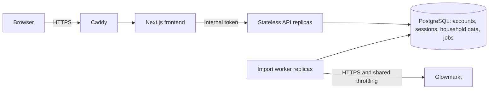

# Hosting Powerall

The hosted app uses PostgreSQL, stateless API processes and separate import workers. Registration remains invite-only. There is **no default account ceiling**; an optional positive `POWERALL_MAX_ACCOUNTS` limits registrations when an operator wants a quota. This is a configuration setting, not a provider limit or a measured capacity claim.

The local launcher still uses SQLite and your local `.env`. Hosted startup never discovers, copies or exposes that data automatically.

## Architecture



- PostgreSQL holds hashed sessions, invitations, login counters and encrypted Bright credentials. Every API replica can validate the same session; password changes and logout revoke access across replicas.
- Shared household tables have tenant-prefixed keys and **forced row-level security**. A transaction sets its tenant from the authenticated server session. The connection pool resets that transaction before reuse. Resource identifiers may safely repeat across households. The application database role is neither a superuser nor a role with `BYPASSRLS`.
- Dashboard queries use indexed tenant/meter/time lookups. The pool bounds database connections and waiting requests. API processes do not own import threads, schedules, tokens or cached credentials.
- Imports enter a durable PostgreSQL queue, coalesced to one outstanding job per household. Workers hold a database advisory lock throughout an import; another worker or credential-change/deletion request cannot concurrently operate on that household. Worker death releases its lock, allowing another worker to replay the job. Each write transaction also checks a unique job ownership token, fencing off a worker that loses its lock connection. Reading/tariff upserts make replay safe. Failed imports retry with exponential backoff capped at one hour; successful imports schedule the next refresh.
- Individual provider HTTP requests, including authentication and retries, reserve globally spaced call slots. HTTP 429 responses extend a shared cooldown. `POWERALL_PROVIDER_INTERVAL_SECONDS` defaults to one second; this is an operator throttle, not a claim about Bright's contractual allowance. Increasing workers does not multiply that configured request rate.
- Housekeeping is claimed once per minute across workers. It removes readings older than 730 days, import history older than 30 days, expired sessions/invitations and old authentication counters. A crash allows the next worker to reclaim housekeeping. Worker heartbeats and aggregate queue state support operational monitoring.

The queue uses PostgreSQL so this deployment does not also require Redis. API and worker services can scale independently. A single Compose host still has finite CPU, memory and database throughput; multiple machines require a shared PostgreSQL endpoint and a load balancer. This implementation has concurrency/integration tests, not a production capacity benchmark.

## Security and privacy

Login passwords use salted PBKDF2-HMAC-SHA256 with 600,000 iterations. Session and invitation tokens are stored as SHA-256 hashes. Cookies use `Secure`, `HttpOnly`, `SameSite=Lax`, `__Host-` and seven-day expiry. Mutations require the configured HTTPS Origin and a signed-in session's CSRF token. Only Next.js receives the internal API token; it never reaches the browser.

Bright credentials use AES-256-GCM with the account UUID as associated data. The mounted key is separate from PostgreSQL and the image. API and workers receive this key; only workers call Bright. Provider tokens stay in worker memory. Redirects are refused, responses are bounded and requests time out. Frontend containers receive neither database passwords nor the credential encryption key.

Only Caddy publishes ports 80/443. Application containers run as UID 10001 with read-only root filesystems, dropped capabilities and resource bounds. PostgreSQL uses its official image and a private persistent volume. Caddy adds HTTPS, HSTS, framing/referrer/CSP restrictions, no-store and noindex. Access logs are disabled; operational logs rotate. No request bodies, credentials, tokens or user identifiers should be added to logs.

Privileged operators/hosting infrastructure can read data and decrypt credentials. Use encrypted host disks: Docker volumes are not inherently encrypted. There is no MFA/SSO or automatic email recovery yet. Specify the actual operator, privacy contact, hosting location and lawful basis; review the app's `/privacy` page against actual operations. Sign-in passwords require at least 12 characters. Each user connects their own Bright account and consent. Revisit provider arrangements if this becomes a public or commercial service.

## Deploy

Use a maintained Docker host, domain and inbound 80/443. Start with enough RAM for PostgreSQL, frontend, API and workers (around 3 GB for the supplied container limits, plus build overhead); size the host from observed load.

```sh
cp deploy/hosting.env.example deploy/hosting.env
# Set domain, ACME email and operator/privacy details.
python3 scripts/create-hosting-secrets.py
# Protect an offline copy of all five generated secrets first.
sudo chown 10001:10001 deploy/secrets/encryption_key deploy/secrets/internal_token deploy/secrets/backup_key deploy/secrets/database_password
sudo chmod 600 deploy/secrets/*
# The official PostgreSQL image must read both database password secrets.
# File-backed Compose secrets preserve host ownership. Grant the container's postgres
# user (UID 999 in this image) read access to database_password and database_admin_password,
# and grant UID 10001 access to database_admin_password for maintenance backups.
# Use host ACLs for these two files; do not make secrets world-readable.
chmod 700 deploy/secrets
chmod 600 deploy/hosting.env

docker compose --env-file deploy/hosting.env config --quiet
docker compose --env-file deploy/hosting.env build --pull
docker compose --env-file deploy/hosting.env up -d
docker compose --env-file deploy/hosting.env ps
```

On Linux with POSIX ACL support, after assigning both database secrets to UID 10001, a typical ACL is:

```sh
sudo chown 10001:10001 deploy/secrets/database_admin_password
sudo setfacl -m u:999:r deploy/secrets/database_password deploy/secrets/database_admin_password
```

The initial database entrypoint creates a dedicated non-superuser application role. A one-shot `migrate` service applies versioned schema changes before API/worker startup. Do not run schema migrations independently from application releases. Changing a database password secret does not update an already initialized PostgreSQL role; rotate the role and secret together.

Caddy obtains certificates once DNS and ports are correct. There are no seeded accounts. Generate a private single-use 48-hour invite:

```sh
docker compose --env-file deploy/hosting.env exec -T api python -m powerall.manage invite
```

The link uses a fragment removed by the login form. Deliver it privately. Account recovery remains an operator action after verifying identity:

```sh
docker compose --env-file deploy/hosting.env exec api python -m powerall.manage reset-password USERNAME
```

There is no public admin API. Pause provider access by setting `POWERALL_BRIGHT_ENABLED=false` and recreating both API and worker services. An already active import finishes before stopping; paused workers continue privacy housekeeping.

Never use `docker compose down -v` on real data unless destroying the persistent volumes is intended.

## Nginx Proxy Manager

Use the explicit `compose.npm.yaml` override when NPM already manages HTTPS. The route becomes browser → NPM HTTPS → Caddy private HTTP on 8080 → frontend → API. Caddy retains the same headers, no-store policy, 16 KB body limit and timeouts as standalone mode. Its HTTP listener has no published host port, no ACME configuration and no HTTPS redirect. The frontend/API/database remain off NPM's network.

Use Docker Compose **2.24.4 or later** because the override explicitly resets published ports and replaces gateway network membership. `scripts/compose-npm.sh` always includes both files; use that wrapper for all Powerall commands in this mode, including builds, scaling, upgrades, backups and restoration. Plain `docker compose up` uses the standalone configuration and would publish 80/443 again.

Choose an unused subnet and a fixed NPM address outside the network's dynamic allocation range, on a dedicated Docker network. For example (replace this subnet if it overlaps your networks):

```sh
docker network create --internal --subnet 172.30.50.0/29 --ip-range 172.30.50.4/30 powerall_proxy
```

Attach **only NPM and Powerall's gateway** to this network. In your NPM Compose configuration, add the external network and pin its address while preserving NPM's existing networks:

```yaml
services:
  app:  # Replace with the service name in your NPM stack.
    networks:
      default: {}
      powerall_proxy:
        ipv4_address: 172.30.50.2
networks:
  powerall_proxy:
    external: true
    name: powerall_proxy
```

If NPM already declares additional networks, preserve them too. NPM needs its existing internet-connected network for certificate renewal; this added network is internal. Recreate the NPM container using its own Compose stack so the fixed address persists across restart. This does not expose NPM's database or admin UI to Powerall.

In `deploy/hosting.env`, set:

```dotenv
POWERALL_DOMAIN=energy.example.com
POWERALL_PROXY_NETWORK=powerall_proxy
POWERALL_TRUSTED_PROXY_CIDRS=172.30.50.2/32
```

`POWERALL_DOMAIN` is the external hostname without a scheme, path or port. Both application services still use `https://energy.example.com` as their exact public origin. `POWERALL_ACME_EMAIL` is unused in NPM mode and can be omitted; NPM owns certificates. Other operator/privacy/database settings and secret permissions still apply.

Trust NPM's **actual fixed address**, not `0.0.0.0/0`, all private networks, or the whole shared subnet. Multiple trusted NPM addresses can be supplied as a space-separated list of exact CIDRs. Caddy refuses direct requests from other peers, strictly parses NPM's `X-Forwarded-For` from the right, and overwrites `X-Powerall-Client-IP` using that result. Browser-supplied client-IP headers are not trusted. A wrong/stale trusted address produces 403; fix the NPM network address instead of broadening trust.

Prepare the same five secrets as standalone deployment, then:

```sh
./scripts/compose-npm.sh config --quiet
./scripts/compose-npm.sh build --pull
./scripts/compose-npm.sh up -d
./scripts/compose-npm.sh ps
./scripts/compose-npm.sh exec -T api python -m powerall.manage invite
```

When switching an existing deployment, recreate its gateway so the old published ports are removed. The wrapper's `up -d` performs that configuration change. Do not delete volumes. The shared network alias is `powerall-gateway`; do not reuse that alias for another application on the same network.

Create an NPM Proxy Host with:

| Setting | Value |
| --- | --- |
| Domain Names | `energy.example.com` (your hostname) |
| Scheme | `http` |
| Forward Hostname/IP | `powerall-gateway` |
| Forward Port | `8080` |
| Cache Assets | Off |
| SSL Certificate | Your certificate, managed by NPM |
| Force SSL | On |

Preserve the public Host and Origin. NPM's normal forwarding configuration supplies the Host, forwarded protocol and client-address chain. Use a dedicated hostname rather than a URL subpath. WebSocket support is not required by the current app. Do not forward to the frontend or API directly: the private Caddy gateway enforces request/header controls.

Disable NPM's access logging for this host if you want the same log-minimisation policy as the supplied gateway. NPM normally writes per-host access logs. Use `access_log off;` in this Proxy Host's Advanced configuration, verify the effective configuration with `nginx -T`, and confirm a test request does not create an access-log entry. NPM and its hosting infrastructure still handle IPs/requests; align retention and the privacy notice with actual proxy logging.

For scaling, backup and other commands below, substitute `./scripts/compose-npm.sh` for `docker compose --env-file deploy/hosting.env`. For example:

```sh
./scripts/compose-npm.sh up -d --scale api=3 --scale worker=2
./scripts/compose-npm.sh --profile tools run --rm -T maintenance > backups/powerall.enc
```

The proxy chain was tested with a disposable nginx TLS frontend using NPM's forwarding-header behaviour, not by altering your existing NPM installation. Test your actual host after deployment: register/sign in, load/export readings, verify security headers and ensure a failed login from one client does not throttle everyone as the proxy's IP.

## NPM through the host's internal IP (no shared network)

Use `compose.npm-ip.yaml` instead of `compose.npm.yaml` when NPM connects to a
published port on the Powerall host's LAN/private IP. No manual network creation
or NPM network changes are required. Compose still creates Powerall's application
networks for isolation. Only the gateway publishes a port; frontend, API and
PostgreSQL remain private.

For example, with Powerall on `192.168.1.50`, NPM on `192.168.1.10`, and the
public hostname `energy.example.com`, set these in `deploy/hosting.env` along
with the operator/privacy settings:

```dotenv
POWERALL_DOMAIN=energy.example.com
POWERALL_GATEWAY_BIND_IP=192.168.1.50
POWERALL_GATEWAY_PORT=8080
POWERALL_TRUSTED_PROXY_CIDRS=192.168.1.10/32
```

The bind IP must belong to the Powerall Docker host. The trusted address must
be the actual source IP that Caddy sees from NPM. For NPM on a different LAN
host this is normally that host's LAN IP. For NPM in Docker on the same host,
Docker routing may preserve its container IP or translate it: inspect the
traffic rather than assuming the host IP. On the Powerall host, run
`sudo tcpdump -ni any 'tcp dst port 8080'` while requesting this NPM Proxy Host,
then trust the observed source as an exact `/32` (or IPv6 `/128`). If it is
NPM's container IP, keep that address stable in NPM's existing network.
Requests with a wrong trusted address receive 403.

Prepare secrets and UID/ACL permissions as described under Deploy. Docker
Compose 2.24.4 or later is required. Use this wrapper for every command:

```sh
./scripts/compose-npm-ip.sh config --quiet
./scripts/compose-npm-ip.sh build --pull
./scripts/compose-npm-ip.sh up -d
./scripts/compose-npm-ip.sh ps
./scripts/compose-npm-ip.sh exec -T api python -m powerall.manage invite
```

Configure the NPM Proxy Host for `energy.example.com` with scheme `http`,
forward IP `192.168.1.50`, port `8080`, Cache Assets off, its managed certificate
and Force SSL on. Preserve Host/Origin and normal forwarded headers. Point
public DNS to NPM; expose only NPM's HTTPS ports publicly. Do not forward
gateway port 8080 from your router. Restrict the gateway port to the NPM
source at the host/network firewall where possible, taking Docker's published
port firewall behaviour into account. Caddy also rejects untrusted peers.

The NPM-to-Powerall hop is HTTP on your private network; use a shared trusted
LAN or VPN for this route. NPM's access-log/privacy settings from the previous
section also apply. Plain `docker compose up` would restore the standalone
80/443 bindings, so always use the IP-mode wrapper for upgrades and maintenance.

## Scale and monitor

For a single host:

```sh
docker compose --env-file deploy/hosting.env up -d --scale api=3 --scale worker=2
docker compose --env-file deploy/hosting.env exec -T api python -m powerall.manage status
```

Docker DNS and the existing reverse proxies route to service replicas; Gunicorn starts two processes per API container. On several hosts, supply the shared database host and route private API traffic through a load balancer. For remote/managed PostgreSQL, set `POWERALL_DATABASE_SSLMODE=verify-full`, mount the provider's CA read-only and set `POWERALL_DATABASE_SSLROOTCERT` to its container path. Set `POWERALL_DATABASE_USER`/`POWERALL_DATABASE_NAME` if needed. Restrict database network access. The included Compose stack assumes its isolated local database network.

Budget connections: API replicas × Gunicorn processes × `POWERALL_DB_POOL_SIZE`, plus worker pools, maintenance and administration must stay below PostgreSQL `max_connections`. The default pool maximum is eight, with one eagerly opened connection per process. Each worker handles one import at a time and may hold a separate advisory-lock connection. Container memory limits apply per replica.

`status` reports active heartbeats and queued/running/idle job counts with oldest availability times, without household identifiers. Alert on no live worker, sustained overdue jobs, repeated database/API health failures, disk growth and backup failures. `/healthz` checks database connectivity on the private API port. Set monitoring cadence and capacity from actual queue lag and provider response times. PostgreSQL can later move to a managed service without changing the dashboard/provider contract; much larger reading datasets may merit time partitioning and aggregate caches based on profiling.

## Migrate existing SQLite data

Stop the old hosted app before copying its private data directory. Keep its original encryption key when migrating encrypted Bright connections. Stop the new API/workers during import. Mount a **copy** of the old directory read-only into the private maintenance service. For example, with an absolute path on the Docker host:

```sh
docker compose --env-file deploy/hosting.env stop api worker
docker compose --env-file deploy/hosting.env --profile tools run --rm \
  -v /protected/old-powerall-data:/legacy:ro maintenance \
  python -m powerall.manage migrate-sqlite --source /legacy
docker compose --env-file deploy/hosting.env start api worker
```

This requires an empty destination account database and imports users, encrypted connections and each household's meters/readings/tariffs/settings/history in one transaction. It excludes old sessions/invitations and applies the old erasure ledger. Verify the credential key before migrating: invalid ciphertext aborts the transaction. It leaves SQLite sources unchanged.

For the original single-user local app, create your hosted account first, then import a read-only copy of `data/` into that account:

```sh
docker compose --env-file deploy/hosting.env --profile tools run --rm \
  -v /protected/local-data-copy:/legacy:ro maintenance \
  python -m powerall.manage migrate-sqlite --source /legacy --username YOUR_USERNAME
```

The target household must be empty. This does not import your local `.env` or automatically connect Bright. Interrupted imports become failed history entries; workers safely re-import as necessary. Re-running a migration into a nonempty household is refused.

## Export, disconnect and delete

Users retain CSV and JSON exports, manual tariff editing, password change, Bright disconnect and password-confirmed deletion. Exports omit credentials/password hashes/tokens. Disconnect removes encrypted credentials and pending jobs, retaining history. Deletion cascades all live account, session, household and queue rows. An active import blocks disconnect/deletion until it finishes.

Deleted UUIDs enter an erasure ledger table in the same transaction as live deletion. That table is excluded from ordinary backup/restore, so restoring old data cannot roll the current ledger back. Preserve the latest ledger independently for disaster recovery to a fresh database. Retain backups for at most 30 days. User downloads are outside server retention.

## Online encrypted backups and restoration

The maintenance container alone receives the backup key and database administrator secret. It uses `pg_dump`'s consistent snapshot and streams a custom-format PostgreSQL archive through AES-256-GCM. The API/workers can remain running during backup. No plaintext dump is written inside the running services.

```sh
mkdir -p backups
chmod 700 backups
umask 077
docker compose --env-file deploy/hosting.env --profile tools run --rm -T maintenance > backups/powerall.enc
```

Check command success and discard incomplete output. Choose unique filenames and enforce a 30-day backup retention schedule. Keep the latest encrypted erasure ledger independently: `docker compose --env-file deploy/hosting.env --profile tools run --rm -T maintenance python -m powerall.manage backup-erasures > backups/erasures.enc`. Decrypt it with the same decryptor and restore its data-only archive into the empty erasure table for disaster recovery to a fresh database. The ordinary encrypted dump excludes that ledger and all secret keys. Keep credential/backup keys offline.

Decrypt into a private recovery directory on an encrypted disk using the project Python environment:

```sh
.venv/bin/python scripts/decrypt-backup.py backups/powerall.enc /protected/backup_key /protected/powerall.dump
```

The script authenticates the archive and removes output if tampered with. Stop API/workers for restore. Mount the dump read-only into maintenance, then restore using the administrator role:

```sh
docker compose --env-file deploy/hosting.env stop api worker
docker compose --env-file deploy/hosting.env --profile tools run --rm \
  -v /protected:/recovery:ro maintenance sh -c \
  'PGPASSWORD="$(cat /run/secrets/database_admin_password)" pg_restore -h database -U postgres -d powerall --clean --if-exists --exit-on-error /recovery/powerall.dump'
# For a fresh database, restore the latest erasures ledger independently BEFORE these steps.
docker compose --env-file deploy/hosting.env --profile tools run --rm maintenance python -m powerall.manage apply-erasures
docker compose --env-file deploy/hosting.env --profile tools run --rm maintenance python -m powerall.manage secure-restored-accounts
docker compose --env-file deploy/hosting.env start api worker
```

Restore into the expected `powerall` database with the dedicated role present. `pg_restore` restores table ownership and forced RLS; do not add `--no-owner`. Applying erasures prevents deleted accounts returning. Securing restored accounts revokes sessions, invalidates restored passwords and clears all Bright connections, preventing a restore from resurrecting superseded access. Verify owners before resetting passwords; each person reconnects Bright. Remove plaintext recovery files. Lost credential keys cannot recover old encrypted connections; replacing that key alone is not a rotation migration.

## Verification

Build the API, frontend and database images before the Docker integration checks (using the NPM wrapper in that mode). The tests use those local images and isolated fixtures.

```sh
.venv/bin/python -m unittest discover -s tests -v
.venv/bin/python scripts/test-hosted-stack.py
.venv/bin/python scripts/test-hosted-stack.py --npm
cd dashboard
node --test lib/energy.test.mjs
npm run typecheck
npm run lint
```

The Docker test uses separate disposable volumes, fake accounts/providers and loopback test TLS. It exercises actual PostgreSQL RLS, session sharing, concurrent workers, crash replay, retries, SQLite migration, HTTPS security controls, non-root/private services, encrypted online backup and restoration with deletion protection. It never reads or copies real credentials or household data. Keep base images/dependencies patched and test restore periodically; these checks do not replace independent security review or load testing.

## Full hosted flow on your computer

The existing `scripts/run.py` launcher uses local SQLite and skips account registration. To test the complete hosted flow, use:

```sh
.venv/bin/python scripts/run-hosted-local.py start
```

This starts a persistent `powerall-local` Docker project with PostgreSQL, accounts, separate workers and the same production frontend/API. Only `https://localhost:8443` is published, bound to loopback. It creates separate keys and a local HTTPS certificate under ignored `data/hosted-local/`; it preserves your original SQLite data and deployment keys. This preview does not need NPM. The local certificate is self-signed: your browser may require a one-time certificate exception for this localhost address. The launcher does not change your system trust store. HSTS is omitted only in local preview so other localhost HTTP apps remain usable.

The command prints a single-use registration invitation and saves it privately in `data/hosted-local/invitation.txt`. Open it, choose your own username/password, then connect Bright under Data & connection. The first import runs through the durable worker queue; once it completes, test charts, tariffs, exports, sign-out/sign-in and account controls. Create another invite to test a separate household:

```sh
.venv/bin/python scripts/run-hosted-local.py invite
.venv/bin/python scripts/run-hosted-local.py status
.venv/bin/python scripts/run-hosted-local.py stop
```

Stopping preserves local PostgreSQL data for the next start. Do not delete the local keys while retaining that database: they protect stored Bright credentials. The local preview's file mounts are readable by their intended Docker Desktop containers, while the enclosing host directories are private (0700). For remote deployment, use the separate production secret/UID/ACL instructions above.

## Gunicorn control socket in read-only containers

The API image starts Gunicorn with `--no-control-socket`. Powerall manages API processes through Docker rather than `gunicornc`; this avoids Gunicorn attempting to create its default socket under the nonexistent, read-only `/home/powerall`. Keep `read_only: true` enabled. For an older deployed image reporting `Control server error: Read-only file system`, copy the updated `deploy/Dockerfile.api`, then run `./scripts/compose-npm-ip.sh build api` and `./scripts/compose-npm-ip.sh up -d api` (or the corresponding wrapper for your deployment mode).

## Upgrade: custom dashboard periods

This release adds `view=custom&date=YYYY-MM-DD&end=YYYY-MM-DD` to the dashboard API.
Both input dates are included; the response's existing `to` field remains exclusive.
Existing day/week/month requests and response fields continue to work. There are no
database schema changes, new secrets or required environment variables. Existing
accounts, sessions, provider connections, readings and tariffs are preserved.

Before upgrading, take an encrypted backup using the existing backup instructions.
Copy the updated source while excluding `.env`, `deploy/hosting.env`, `deploy/secrets/`,
`data/` and `backups/`; keep the current database volumes and keys. For the deployed
NPM host-IP mode, run:

```sh
./scripts/compose-npm-ip.sh config --quiet
./scripts/compose-npm-ip.sh build api frontend
./scripts/compose-npm-ip.sh up -d
./scripts/compose-npm-ip.sh ps
```

Refresh the browser after the services are healthy. If deploying images separately,
update the API before the frontend: the old API cannot serve custom-range requests.
A short interruption is possible during single-host container recreation. Verify
sign-in, an existing calendar view, a custom range, daily drill-down and CSV export.
Do not use `down -v`. A rollback to the prior API/frontend images needs no database
rollback for this release; keep the same secrets and configuration.
