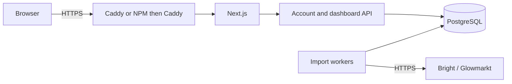

# Hosting Powerall

Use hosted mode for remote access or more than one household. It provides invite-only accounts, encrypted Bright credentials, PostgreSQL storage and background import workers.

For a local Docker preview with temporary development certificates, use `scripts/run-hosted-local.py` as described in the README. The instructions here are for a server with a real HTTPS hostname.

## What runs where



Only the gateway is published. The API, frontend and database communicate on private Docker networks. The API and workers can have multiple replicas; accounts, sessions, import jobs and provider throttling are shared in PostgreSQL. Household data uses tenant-scoped keys and forced row-level security.

A single Compose host still has finite resources. Start with enough memory for the configured service limits (roughly 3 GB, plus operating system and build overhead), then size from actual usage. There is no tested maximum household capacity.

## Requirements

- Docker and Compose **2.24.4 or later**.
- Python 3.10+ to generate secrets.
- A server you control, persistent storage and a public hostname.
- HTTPS, either through the included Caddy gateway or an existing reverse proxy.
- A backup plan for the database, credential key, backup key and deletion ledger.

## Configuration and secrets

From a fresh checkout:

```sh
cp deploy/hosting.env.example deploy/hosting.env
python3 scripts/create-hosting-secrets.py
chmod 600 deploy/hosting.env
```

Edit `deploy/hosting.env` with your hostname and operator/privacy details. These values appear on the privacy page and should describe your actual service. Each user supplies their own Bright credentials after signing in; do not put a shared household's Bright password in this file.

The generator creates five secrets under `deploy/secrets/` and preserves files that already exist. Keep protected copies separately from the server. The credential encryption key is required to recover saved Bright connections; the backup key is required to decrypt backups.

On a standard Linux Docker host, application containers use UID 10001 and the supplied PostgreSQL image uses UID 999. File-backed Compose secrets must be readable by those users. With POSIX ACL support:

```sh
sudo chown 10001:10001 deploy/secrets/*
sudo chmod 600 deploy/secrets/*
sudo setfacl -m u:999:r deploy/secrets/database_password deploy/secrets/database_admin_password
chmod 700 deploy/secrets
```

Adapt ownership for rootless Docker or hosts with different UID mappings. Do not solve permission errors by making secrets world-readable. Changing a password file does not change an existing PostgreSQL role's password; those must be rotated together.

## Choose the gateway mode

| Mode | Compose command prefix | Public entry point |
| --- | --- | --- |
| NPM through a private host IP | `./scripts/compose-npm-ip.sh` | NPM provides HTTPS |
| NPM on a shared Docker network | `./scripts/compose-npm.sh` | NPM provides HTTPS |
| Standalone Caddy | `docker compose --env-file deploy/hosting.env` | Caddy publishes 80/443 |

Use the same prefix for every command in a deployment. Plain `docker compose` omits the hosting env file and NPM override.

### NPM through a private host IP

This option does not require creating a shared Docker network with NPM. Set the following in `deploy/hosting.env`, replacing the example addresses:

```dotenv
POWERALL_DOMAIN=energy.example.com
POWERALL_GATEWAY_BIND_IP=192.168.1.50
POWERALL_GATEWAY_PORT=8080
POWERALL_TRUSTED_PROXY_CIDRS=192.168.1.10/32
```

The bind address must belong to the Powerall Docker host. The trusted proxy must be the **actual source address Caddy sees**. If NPM is on another computer this may be its LAN IP. If NPM runs in Docker on the same computer, NAT may make the source a Docker bridge gateway instead. Inspect the connection rather than guessing; a wrong trusted address returns 403.

Trust exact proxy addresses, not all private networks. If NAT makes several clients share the trusted address, restrict the published gateway port with a firewall so only NPM can reach it. The source-IP rule alone cannot distinguish those clients.

Start Powerall:

```sh
./scripts/compose-npm-ip.sh config --quiet
./scripts/compose-npm-ip.sh build
./scripts/compose-npm-ip.sh up -d
./scripts/compose-npm-ip.sh ps
```

In NPM, create a Proxy Host for the public hostname:

- Forward using **HTTP** to the Powerall host's private IP and configured gateway port.
- Preserve the public hostname. Use the root of a dedicated hostname, not a URL subpath.
- Configure a valid certificate and force HTTPS.
- Leave caching disabled. WebSocket support is not required.
- Do not forward directly to the API or frontend.

`localhost` inside an NPM container refers to that container, not the Docker host.

### NPM on a shared Docker network

The alternative `compose.npm.yaml` attaches only the gateway to an existing external network and removes its published ports. Set `POWERALL_PROXY_NETWORK`, `POWERALL_DOMAIN` and the actual fixed NPM peer address in `POWERALL_TRUSTED_PROXY_CIDRS`. Keep unrelated containers off that network.

Use `./scripts/compose-npm.sh` for configuration checks, builds and startup. In NPM, forward HTTP to `gateway` on port `8080`. NPM retains its own internet-connected network for certificate renewal.

### Standalone Caddy

Set `POWERALL_DOMAIN` and `POWERALL_ACME_EMAIL`. Point DNS at the server and allow inbound ports 80/443. Use the standalone prefix from the table for `config --quiet`, `build` and `up -d`. Caddy handles certificates and HTTPS.

The commands below use the NPM host-IP wrapper. Substitute your selected prefix if using another gateway mode.

## Accounts and imports

There are no default accounts. Generate a private, single-use invitation, valid for 48 hours:

```sh
./scripts/compose-npm-ip.sh exec -T api python -m powerall.manage invite
```

Open the invitation, create an account and connect Bright under **Data & connection**. Do not share invitation links publicly. Account passwords must have at least 12 characters.

Imports run in a shared queue. A failed job retries after 1–15 minutes; a manual retry brings it forward after the existing one-minute request cooldown. Bright rate limits can still delay requests. Completed chunks and saved readings remain available after a failure.

An operator can inspect aggregate worker and queue state or reset an account password after verifying the account owner's identity:

```sh
./scripts/compose-npm-ip.sh exec -T api python -m powerall.manage status
./scripts/compose-npm-ip.sh exec api python -m powerall.manage reset-password USERNAME
```

There is no public admin interface, email recovery, MFA or SSO. `POWERALL_MAX_ACCOUNTS` optionally limits registrations; leaving it empty does not imply unlimited capacity. Set `POWERALL_BRIGHT_ENABLED=false` and recreate API/worker services to pause provider access. Active imports may finish before workers stop.

## Data protection and retention

Bright credentials use authenticated encryption with a separate key. Passwords are hashed and sessions are stored as token hashes. Cookies are Secure, HttpOnly and SameSite; writes require the configured Origin and CSRF token. Provider tokens stay in worker memory.

Containers use private networks, restricted privileges and read-only application filesystems. The gateway supplies security headers and disables caching. Do not add request bodies, credentials or user identifiers to logs. Docker volumes are not encrypted automatically; protect the host and backup storage. Operators with the key and database access can decrypt Bright credentials.

Registration and sign-in have separate attempt limits. Sign-in remains limited per IP and per account. `POWERALL_AUTH_CONCURRENCY` defaults to four simultaneous password operations across all API replicas; excess requests receive a temporary 429 response. Use the same setting for every replica and tune it to available CPU capacity. These controls do not replace request limiting at the public proxy.

Hosted housekeeping removes readings older than 730 days and import history older than 30 days. Account exports omit credentials. Disconnecting Bright removes its credentials and pending jobs but keeps readings. Account deletion removes live account and household data and records the deletion in an erasure ledger. An active import blocks disconnect/deletion until it finishes.

Review [SECURITY.md](SECURITY.md) and the app's privacy page before inviting others. Provider access and consent are separate from this project's open-source license.

## Backups and recovery

The maintenance container creates an encrypted PostgreSQL snapshot while the app stays online. Keep backups private, check the command succeeded, and retain the latest deletion ledger independently. The regular database backup deliberately excludes that ledger and does not contain deployment secret keys.

```sh
mkdir -p backups
chmod 700 backups
umask 077
./scripts/compose-npm-ip.sh --profile tools run --rm -T maintenance > backups/powerall.enc
./scripts/compose-npm-ip.sh --profile tools run --rm -T maintenance python -m powerall.manage backup-erasures > backups/erasures.enc
```

Use unique filenames for subsequent backups and discard incomplete output. Set a retention policy of at most 30 days. Store the keys separately and test recovery before relying on a backup.

To recover, decrypt into a private directory on an encrypted disk using the Python environment with `requirements-hosted.txt` installed:

```sh
.venv/bin/python scripts/decrypt-backup.py backups/powerall.enc /protected/backup_key /protected/powerall.dump
```

Stop API and worker services before restoring. Restore to the expected database with the dedicated application role present, preserving table ownership and row-level security. For example, with the dump in `/protected`:

```sh
./scripts/compose-npm-ip.sh stop api worker
./scripts/compose-npm-ip.sh --profile tools run --rm \
  -v /protected:/recovery:ro maintenance sh -c \
  'PGPASSWORD="$(cat /run/secrets/database_admin_password)" pg_restore -h database -U postgres -d powerall --clean --if-exists --exit-on-error /recovery/powerall.dump'
```

If recovering to a fresh database, decrypt and restore the **latest** erasure-ledger backup into its empty table as well. On an existing deployment, preserve its current ledger. Before restarting, apply deletions and invalidate restored account access:

```sh
./scripts/compose-npm-ip.sh --profile tools run --rm maintenance python -m powerall.manage apply-erasures
./scripts/compose-npm-ip.sh --profile tools run --rm maintenance python -m powerall.manage secure-restored-accounts
./scripts/compose-npm-ip.sh start api worker
```

These steps prevent deleted accounts, old sessions and superseded Bright connections from returning. Verify account owners before resetting passwords; users reconnect Bright themselves. Remove decrypted recovery files afterward. Never remove real persistent volumes as a routine operation.

## Repository utilities

- `scripts/upgrade.sh`: applies the current local source to an existing NPM host-IP deployment. It does not fetch source code or upgrade PostgreSQL.
- `scripts/run-hosted-local.py`: manages the separate local Docker preview.
- `scripts/test-hosted-stack.py`: checks an isolated test deployment with fake accounts and providers; see [CONTRIBUTING.md](CONTRIBUTING.md).

Production load capacity and independent security assessment remain outside the current validation coverage.
