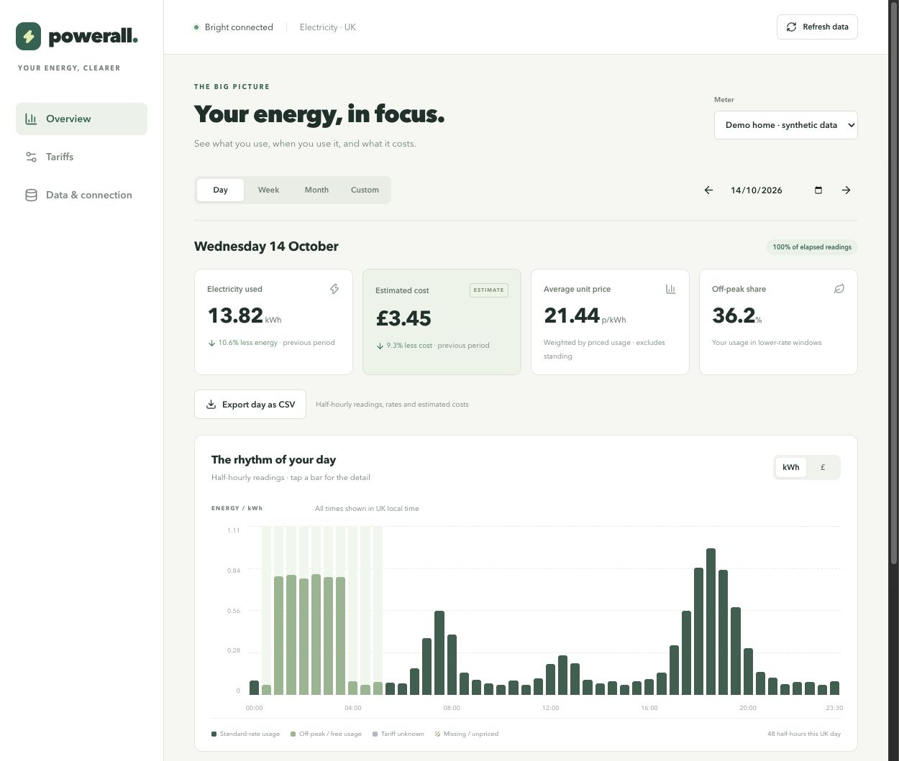

# Powerall

Powerall is a mobile-friendly dashboard for UK smart-meter electricity data. It combines half-hourly consumption from Bright / Hildebrand Glowmarkt with your tariff history to show when you use electricity and what it costs.

Run it on your own computer for one household, or self-host the Docker version with separate, invite-only household accounts. Powerall is an independent project and is not affiliated with Bright, Hildebrand or an energy supplier.

## Why Powerall?

Some electricity suppliers offer useful dashboards; others provide less detail or a different experience. Powerall aims to streamline this into one consistent way to understand your electricity use, tariff costs and changes over time.

It brings consumption, historical tariffs, off-peak and free-hour windows, comparisons and exports into a single self-hosted interface. You can keep your data on a server you control and explore it in the same way as the project gains more integrations.

Bright is the first supported data source. Additional sources, including Octopus Energy, are planned so the experience can become more unified across providers. Multi-provider support is a goal, rather than a feature available today.



## What it does

- Day, week, month and custom date views, with comparisons to the previous period.
- Usage and estimated costs, including standing charges, off-peak windows and free hours on selected weekdays.
- Historical tariffs you can add and edit, including VAT and UK/UTC time settings.
- Clear indicators for missing readings, unknown prices and delayed data.
- CSV export for a selected period; account data export in hosted mode.
- Background imports and retries, with a manual refresh option.
- Responsive charts, keyboard previews and touch hold-and-slide previews.

On desktop, hover over a daily bar to see its numbers. On a phone, hold for about half a second and slide between bars. A quick tap opens the day's half-hourly readings.

## Choose how to run it

| Mode | Use it for | Storage | Access |
| --- | --- | --- | --- |
| Local | One household on your computer | SQLite | Loopback only, no account login |
| Hosted | Remote access or separate households | PostgreSQL | HTTPS and invite-only accounts |

The modes keep separate data. Starting hosted mode does not copy your local readings or Bright credentials.

### Quick start: local dashboard

Requirements: Python 3.10+, Node.js 22.13+ and npm. Node.js 24 is used by the Docker build. The local Python service uses the standard library; Python must have UK timezone data available.

From the project directory:

```sh
cp .env.example .env
# Add your Bright username and password to .env.
cd dashboard
npm ci
cd ..
python3 scripts/run.py
```

Open **http://127.0.0.1:5173**. Stop the app with Ctrl+C. The initial import looks back 90 days, subject to Bright availability. Later refreshes normally re-fetch the previous 14 days to pick up corrections. The settings in `.env.example` control the initial lookback and refresh frequency.

Keep `.env` private. Bright credentials belong on the server, never in frontend environment variables. The local launcher has no account authentication and must not be exposed to the internet.

### Try the account flow locally

Requirements: Docker with Compose 2.24.4+ and Python 3.10+.

```sh
python3 -m venv .venv
.venv/bin/python -m pip install -r requirements-hosted.txt
.venv/bin/python scripts/run-hosted-local.py start
```

Open the invitation printed by the launcher. The preview uses **https://localhost:8443** with a self-signed certificate; your browser may ask you to trust that local certificate. Create an account, then connect Bright under **Data & connection**. The minimum account password length is 12 characters.

Use the same launcher with `invite`, `status` or `stop` to manage the preview. Stopping it preserves its data. For remote hosting, see [HOSTING.md](HOSTING.md).

## Understanding the numbers

Consumption is stored by UTC interval start and displayed in UK local time. Clock-change days have 46 or 50 half-hours instead of 48. Repeated autumn times are labelled BST or GMT.

Estimated cost adds each interval's usage multiplied by its rate, plus one standing charge per UK calendar day. Manual tariffs override Bright tariffs for their effective dates. Tariff end dates are exclusive; custom dashboard end dates are inclusive.

Missing readings stay missing rather than becoming zero. An actual zero remains zero. Incomplete costs are shown as a subtotal or unavailable, and comparisons are withheld when the required readings or prices are missing. CSV exports preserve these gaps.

## Current limitations

- **Bright is the only implemented provider.** A working Bright account, meter consent and available provider history are required. A longer import cannot recover data Bright does not supply.
- **Electricity consumption only.** Gas, export, live power and cumulative meter-register readings are not imported. Documented provider endpoints do not guarantee that a particular account supplies those values.
- **Costs are estimates, not a bill reconciliation.** Supplier rounding, discounts, intelligent charging adjustments and complex dynamic or block tariffs are not fully modelled.
- **Imported tariffs can be incomplete.** Bright's VAT and tariff-window time conventions may be unclear. Check the warnings and enter confirmed manual rates when needed.
- **Retention and range limits apply.** Hosted readings are retained for 730 days. Custom dashboard ranges are limited to 366 days. Provider requests are made in chunks of up to ten days.
- **Hosted registration is invite-only.** There is no email password recovery, MFA or SSO. Operators handle account recovery.
- **Touch support needs more device testing.** Gesture logic is tested automatically, but physical iPhone/browser coverage is limited.
- **Scaling is not unlimited.** API and worker replicas share PostgreSQL and provider throttling. There is no published capacity benchmark or independent security audit.

See [ROADMAP.md](ROADMAP.md) for planned work and ideas under consideration.

## Privacy and security

Hosted Bright credentials are encrypted at rest with a key kept separate from the database. Account passwords are hashed. Operators who control the server and encryption key can still access household data; the app does not provide end-to-end encryption.

No analytics or third-party fonts are added by the app. Credentials, databases, backups and local screenshots are excluded from Git and Docker build contexts. Keep your own backups and protect the deployment keys.

Read [SECURITY.md](SECURITY.md) before reporting a vulnerability, and [HOSTING.md](HOSTING.md) before exposing the app publicly.

## Development and contributing

See [CONTRIBUTING.md](CONTRIBUTING.md) for setup, tests and contribution guidance. [VERIFICATION.md](VERIFICATION.md) describes validation coverage and its limits. The release version is in [VERSION](VERSION).

Bug reports and feature requests are welcome through this repository's Issues page. Remove credentials, meter identifiers and household details from logs and screenshots before sharing them.

## License

Powerall is licensed under the [MIT License](LICENSE). Third-party notices are listed in [THIRD_PARTY_NOTICES.md](THIRD_PARTY_NOTICES.md). The license does not grant access to Bright or change its service terms.
